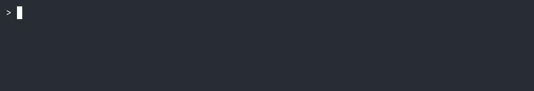

<div style="text-align: center;">

<h3>Unix-native AI agent runtime</h3>
<div style="text-align: center; margin-bottom: 0px; font-size: 19px;">
Agents are bundles.
</div>
<div style="text-align: center; margin-bottom: 0px; font-size: 19px;">
Tools are scripts.
</div>
<div style="text-align: center; margin-bottom: 0px; font-size: 19px;">
Composition is pipes. 
</div>
<div style="text-align: center; margin-bottom: 10px; font-size: 19px; font-weight: bold;">
The runtime is Bash.
</div>

</div>


---

## What SlyM is

In SlyM, an agent is three things:

- **the user prompt** — what to do;
- **a bundle** — a directory containing `SKILL.md` (persona and policy),
  `schemas/` (tool declarations), and `tools/` (scripts);
- **an LLM** — the reasoner.

SlyM is the small corner where those three meet on your Unix system:
it takes the prompt, loads the bundle, calls the LLM, runs the tools,
and writes the trace. The runtime is a few lines of Bash. It has no
session store, no registry, no sandbox, and no general invocation path
— because the shell, the file, and the OS already have those, and
slym's job is to *meet* them, not to *replace* them.

> **SlyM is the corner. The shell is the room.**

---

## Getting started

Install:

```bash
curl -fsSL https://raw.githubusercontent.com/p-phi/slym/main/install.sh | bash
```

Point it at a model:

```bash
export SLYM_ENDPOINT="http://localhost:11434/v1/chat/completions"
export SLYM_MODEL="llama3.2"
```

Run an agent (a directory containing one or more bundles):

```bash
slym bundles/shell-run --run "what's in this repository?"
```

**Dependencies:** `bash`, `curl`, `jq` — plus whatever a tool script
invokes (`git` for the shell bundle, `python3` for a Python tool).

Two agents ship with the repo:

- **`bundles/shell-run`** — a restricted shell. One tool, `run`, which
  accepts a single command from a fixed allowlist (`ls`, `cat`, `head`,
  `tail`, `wc`, `grep`, `git status`, `git diff`, `git log`).
- **`bundles/make-bundle`** — builds bundles from a prompt. Its skill is
  `make-bundle`, and it's the design applied to itself: an agent whose
  skill is producing agents.

---

## Bundles

A bundle is a directory. That's the whole format. Its contents are:

```
skills/shell-run/
  SKILL.md              # persona and policy (prose)
  schemas/
    run.json            # tool declaration (JSON Schema)
  tools/
    run.sh              # the executable the tool runs
```

**`SKILL.md`** is prose. It is concatenated into the system prompt
verbatim. The harness never parses it — it is the model's instructions,
the bundle author's documentation, and the bundler's prompt, all in one
text.

```markdown
---
name: shell
description: Run read-only commands from an allowlist
---

You can run a small set of read-only commands with the `run` tool.

The allowlist is: ls, cat, head, tail, wc, grep, git status, git diff,
git log.

That is the whole list. You cannot run anything else — not `rm`, not
`curl`, not a pipeline, not a redirect.

If you need a command that is not on the list, say so. Do not try to
work around the allowlist.
```

`schemas/*.json` declare tools. Each file is one tool: its name,
its description, its parameters, and the script that runs it.
`parameters` is a flat map of name → description. 

Append `?` to aparameter name to mark it optional. 

The harness expands every parameter
to the provider's `string` type and derives `required` from the `?`
suffix. The bundle never declares types.

```json
{
  "name": "run",
  "description": "Run a single read-only command from the allowlist. No pipes, redirects, subshells, or command substitution.",
  "script": "tools/run.sh",
  "parameters": {
    "command": "A single command from the allowlist, e.g. 'ls -la', 'cat README.md', 'git status'."
  }
}
```

The same file, with an optional parameter:

```json
{
  "name": "grep",
  "description": "Search files for a pattern.",
  "script": "tools/grep.sh",
  "parameters": {
    "pattern": "The regex to search for.",
    "path?":   "Optional: file or directory to search (default: current dir)."
  }
}
```
There is no `enum`, no `format`, no nested
`properties`: the bundle surface is **description + optionality**, and
everything else is the tool's job.

`tools/*.sh` are the executables the model calls. They read their
arguments as JSON on stdin and write their result to stdout. They can be
written in any language; a shebang is the only requirement. The harness
runs each tool and records three channels in the trace:

```json
{"ok": false, "exit": 1, "stdout": "", "stderr": "error: 'rm -rf /' is not in the allowlist."}
```

ok is derived from the exit code; stdout and stderr are kept
separate so the trace can tell which channel diverged. On success:

```json
{"ok": true, "exit": 0, "stdout": "README.md\nLICENSE\n", "stderr": ""}
```

```bash
#!/usr/bin/env bash
set -euo pipefail

ALLOWLIST=(
  "ls" "cat" "head" "tail" "wc" "grep"
  "git status" "git diff" "git log"
)

command=$(jq -r '.command' <<<"$(cat)")

for allowed in "${ALLOWLIST[@]}"; do
  if [[ "$command" == "$allowed"* ]]; then
    exec $command
  fi
done

echo "error: '$command' is not in the allowlist." >&2
echo "allowed: ${ALLOWLIST[*]}" >&2
exit 1
```

**A bundle can be as small as one file.** A bundle with only `SKILL.md`
is a conversational agent: it reasons and responds, but has no action
surface. `schemas/` and `tools/` are optional.

**A bundle can be a composition.** A directory containing multiple
bundles is a bundle of bundles. `slym skills/` loads every bundle under
`skills/`, and the model can call every tool they declare. This is how
you compose capabilities without writing a framework.

**Bundles are portable.** A bundle is a directory, so you can copy it,
`git` it, `tar` it, or `scp` it to another machine. It has no runtime
dependencies beyond what its scripts invoke. The format is the bundle;
the bundle is the directory.

---

## Workflows

**Compose agents with pipes.** The pipe carries the trace, so the next
agent resumes the conversation:

```bash
cat legacy_setup.sh \
  | slym skills/analyzer --run "extract system package dependencies" \
  | slym skills/generator --run "write a safe, idempotent apt-get script" \
  > install.sh
```

**Save and resume a session.** The trace is the state:

```bash
slym skills/shell-run --trace --run "audit this repo" > session.jsonl
slym skills/shell-run --trace --run "now fix the issues" < session.jsonl
```

**Inspect the trace.** `--trace` emits wrapped JSONL on stdout:

```bash
slym --trace skills/shell-run --run "list files" \
  | jq -c '.["trace"] | select(.role=="tool") | .content'
```

**Fork a session.** The trace is a file; copying is branching:

```bash
cp session.jsonl branch-a.jsonl
slym skills/shell-run --run "try approach A" < branch-a.jsonl
```

**Truncate the window.** The context policy is a pipeline stage:

```bash
tail -n 40 session.jsonl | slym skills/shell-run --run "continue"
```

**Give the agent a sandbox.** One `ssh` wrapper, no runtime feature:

```bash
# skills/sandbox/tools/sandbox_exec.sh
#!/usr/bin/env bash
set -euo pipefail
command=$(jq -r '.command' <<<"$(cat)")
exec ssh sandbox-host -- "$command"
```

---

## Status

Early. The loop, the loader, the self-describing schema, and the trace
are the interesting parts. If you build a bundle, add a provider, or
port the harness, the design is the contribution and the code is the
proof.

## License

MIT.

